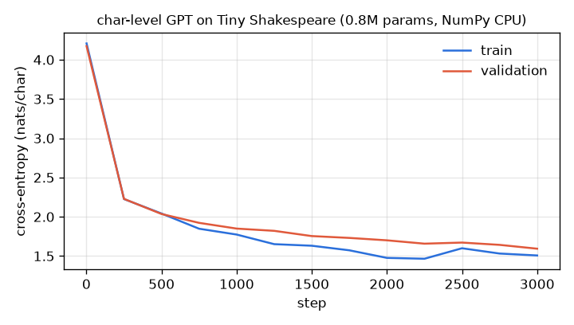
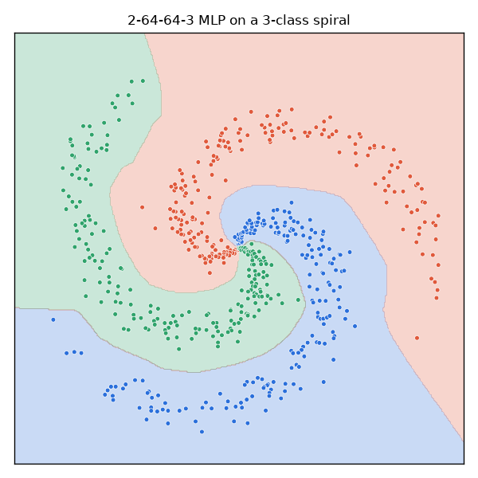
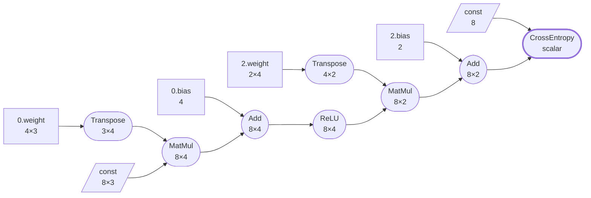

# tensile: a deep-learning framework built from scratch on NumPy

[](https://github.com/pMag11-alt/tensile/actions/workflows/ci.yml)


tensile is a small PyTorch-style deep-learning library: a reverse-mode **autodiff engine**, a
**module system**, **layers** from `Linear` to `Conv2d` to multi-head **attention**,
**optimisers**, **LR schedules** and a **data loader**. It's about 2,600 lines of Python, and its
only dependency is NumPy. No PyTorch or JAX under the hood: every forward and backward pass is
written out by hand.

It's fast enough to train real models on a laptop CPU:

| Model | Data | Result | Training time (M3 CPU) |
| --- | --- | --- | --- |
| MLP (235k params) | MNIST | **98.2%** test accuracy, 3 epochs | 3 s |
| CNN with BatchNorm (207k params) | MNIST | **99.3%** test accuracy, 3 epochs | 90 s |
| Character-level GPT (0.8M params, 4 layers) | Tiny Shakespeare | **1.59** validation loss, 3,000 steps | 6 min |
| 2-64-64-3 MLP | 3-class spiral | **99.7%** accuracy | under 1 s |

Its gradients are checked against finite differences for every op, and against **PyTorch**:
the same CNN trained for several Adam steps in tensile and in torch ends up with the same weights
to 1e-9.

<p align="center">
  
  
</p>

## Quick start

```bash
git clone https://github.com/pMag11-alt/tensile.git
cd tensile
python -m venv .venv && source .venv/bin/activate
pip install -e '.[dev,plots]'

python examples/mnist.py --model cnn --epochs 3   # downloads MNIST (11 MB) on first run
python examples/char_gpt.py --steps 3000          # trains the GPT, then writes Shakespeare
python examples/spiral.py --out spiral.png
pytest                                            # 195 tests
```

The API follows PyTorch's, so it should look familiar:

```python
import tensile as ts
import tensile.nn as nn
import tensile.functional as F

model = nn.Sequential(
    nn.Conv2d(1, 16, 3, padding=1), nn.BatchNorm2d(16), nn.ReLU(), nn.MaxPool2d(2),
    nn.Flatten(), nn.Linear(16 * 14 * 14, 10),
)
opt = ts.optim.AdamW(model.parameters(), lr=2e-3)

for x, y in ts.data.DataLoader(train_set, batch_size=64, shuffle=True):
    opt.zero_grad()
    loss = F.cross_entropy(model(x), y)
    loss.backward()
    opt.step()
```

And this is what the GPT wrote after six minutes of training (it has never seen a word list,
only characters):

```text
ROMEO:
That I pray your drawn little to the at passage.

GLOUCESTER:
My lord the bear news?

KING HENRY VI:
You seem the gracious soul me prays, the had I
prove the nature of blood's hereat: I am speak
Not seal thus soile fell to thee.
```

## What's inside

| Area | Contents |
| --- | --- |
| Autodiff ([`tensor.py`](tensile/tensor.py), [`ops.py`](tensile/ops.py)) | `Tensor` with NumPy broadcasting; 37 differentiable primitives including `matmul` with batch broadcasting, fancy indexing (repeated indices accumulate), `concat`/`stack`/`pad`, numerically stable fused `log_softmax` and `cross_entropy`, im2col `conv2d`, max/avg pooling and fused `layer_norm`; `no_grad`, `retain_grad`, custom `Function`s |
| Layers ([`nn/`](tensile/nn)) | `Linear`, `Conv2d`, `MaxPool2d`, `AvgPool2d`, `BatchNorm1d/2d` (with running statistics), `LayerNorm`, `Embedding`, `Dropout`, `MultiheadAttention` (with optional causal mask), `TransformerBlock`, activations; `Module` with parameter registration, `state_dict`, `train`/`eval`, weight tying and dtype casting |
| Optimisation ([`optim/`](tensile/optim/__init__.py)) | `SGD` (momentum, Nesterov), `Adam`, `AdamW`, `RMSprop`, parameter groups; `StepLR`, `CosineAnnealingLR`, `LambdaLR`, warm-up + cosine; gradient clipping |
| Data ([`data.py`](tensile/data.py), [`datasets.py`](tensile/datasets.py)) | `Dataset`, `TensorDataset`, `DataLoader` (vectorised batching, shuffling), `random_split`; MNIST and Tiny Shakespeare downloaders with checksums |
| Tooling | `gradcheck` (finite differences), `to_mermaid` / `to_dot` graph rendering, `save` / `load` |

## How the autodiff engine works

Every operation is a `Function` with a `forward` that computes on raw NumPy arrays and a `backward`
that turns the gradient of its output into gradients of its inputs. When an input requires
gradients, applying a Function records it on the output tensor, so the program builds its own
computation graph as it runs. Here is the graph for a two-layer MLP's loss, drawn by
`ts.to_mermaid(loss, params=dict(model.named_parameters()))`. Boxes are parameters, slanted boxes
are constants (the input batch and the labels), and rounded nodes are ops:



`loss.backward()` sorts this graph topologically, with an iterative DFS so a 20,000-op chain
doesn't hit Python's recursion limit. It then walks the graph in reverse, adding up the gradients
of tensors that feed several ops. Broadcasting is undone on the way back: when `(8, 4) + (4,)`
broadcasts the bias, its gradient is summed back down to `(4,)`.

A few implementation details:

- **Convolution** uses im2col. `sliding_window_view` exposes every 3×3 patch as a strided view with
  no copy, then a reshape turns the convolution into one large matrix multiply that BLAS handles.
  The backward pass scatters gradients back with one strided add per kernel offset, not one per
  pixel.
- **Cross-entropy** is fused with log-softmax. That makes it stable for logits of ±1000, and its
  backward pass is simply `softmax(x) - onehot(y)`. It supports label smoothing and `ignore_index`.
- **Max** reductions split the gradient evenly between tied maxima, so the result is a valid
  subgradient.
- **Sigmoid** branches on the sign of its input, so `exp` never overflows.
- **Optimisers** follow PyTorch's update rules exactly. The parity tests check this, including
  AdamW's decoupled weight decay and Nesterov momentum.

## Testing

```bash
pytest                              # 195 tests, about 2 seconds
pytest tests/test_torch_parity.py   # needs torch, otherwise skipped
```

- **113 gradient checks** ([`test_gradcheck.py`](tests/test_gradcheck.py)) compare each op's
  backward pass with central differences in float64. They cover every op under several
  broadcasting patterns, convolutions with different strides and paddings, overlapping pooling
  windows, and attention with and without the causal mask. The check weights the output randomly
  instead of summing it, so errors that would cancel out still show up. There's also a test that
  the checker catches a deliberately wrong backward pass.
- **23 PyTorch parity tests** ([`test_torch_parity.py`](tests/test_torch_parity.py)) cover op
  outputs and gradients, every optimiser's trajectory, a pre-norm transformer block against a
  hand-written torch version, and a CNN with BatchNorm trained for five Adam steps. That last test
  must match torch's weights, BatchNorm running statistics and eval-mode outputs to 1e-9.
- **Engine and layer tests** check gradient accumulation, diamond graphs, `no_grad` and `detach`,
  that causal attention never leaks gradients from future tokens, dropout's scaling, and
  `state_dict` round trips.
- **Learning tests** train small models to solve XOR, the spiral, an oriented-edge task that a
  CNN must learn, and a sequence that a tiny transformer must memorise.

CI runs the suite on Python 3.10, 3.12 and 3.13, then runs the PyTorch parity tests with CPU torch.
Finally it runs the examples: the MNIST MLP must reach 95% after one epoch.

## Layout

```
tensile/
  tensor.py      Tensor, Function, the backward pass, no_grad
  ops.py         every differentiable primitive (forward + backward)
  functional.py  stateless layers and losses (the F in `import tensile.functional as F`)
  nn/            Module, Parameter, layers, initialisers, gradient clipping
  optim/         optimisers and learning-rate schedules
  data.py        Dataset, DataLoader
  datasets.py    MNIST, Tiny Shakespeare, spiral
  gradcheck.py   finite-difference gradient checking
  viz.py         computation graph to Mermaid / Graphviz
examples/        mnist.py, char_gpt.py, spiral.py, plot_loss.py
tests/           195 tests
```

## Limitations

tensile is written for clarity first and speed second. It runs on the CPU only, and has no
second-order gradients (the backward pass is not itself differentiated). It also has no in-place
ops on tensors that require gradients. NumPy's BLAS makes the matrix multiplies fast, but Python
overhead per op means that small models are dominated by bookkeeping.

## License

MIT
